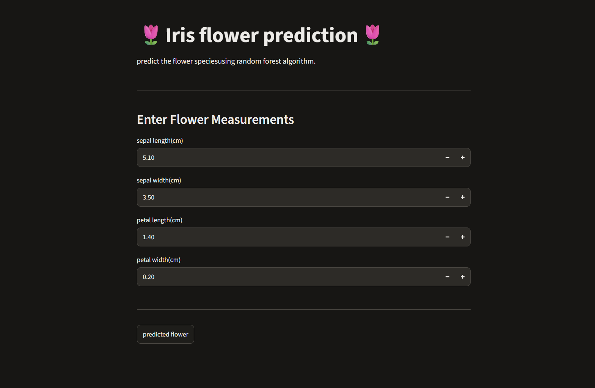
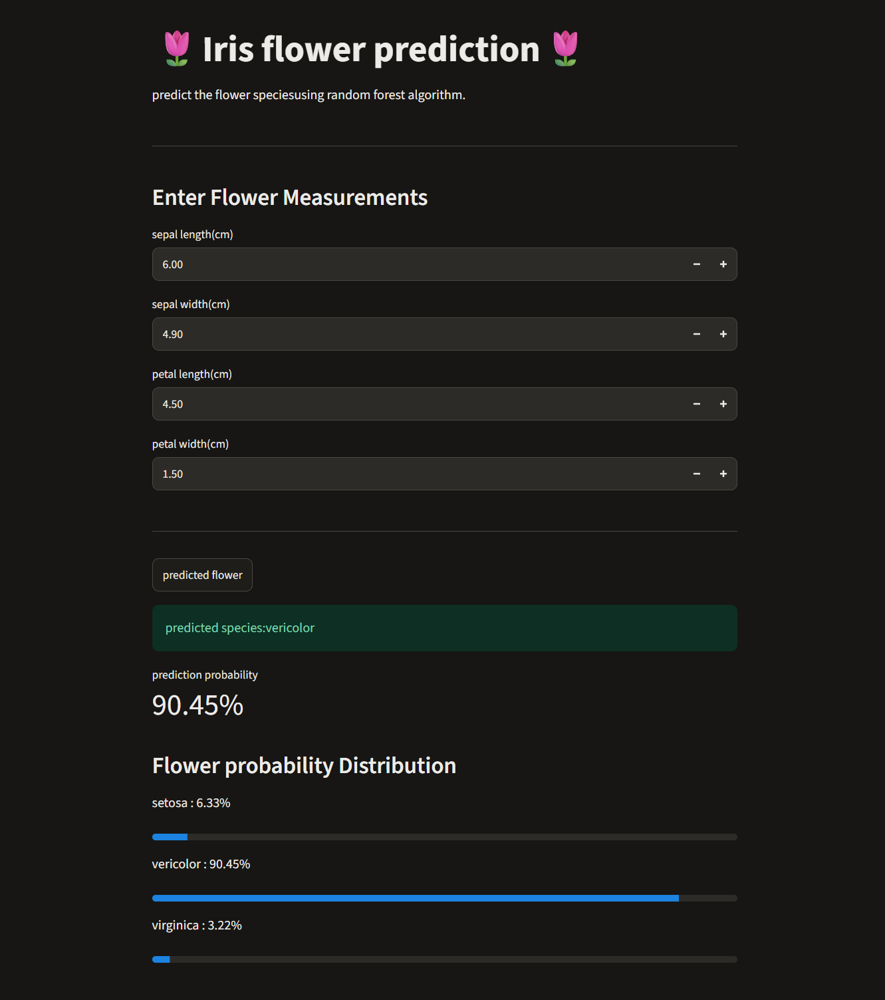

# 🌷 Iris Flower Prediction Using Random Forest

## 📌 Project Overview

This project predicts the species of an Iris flower using a Machine Learning classification algorithm called Random Forest.

The application takes four flower measurements as input and predicts one of the following species:
- Setosa
- Versicolor
- Virginica

The model is integrated with a Streamlit web application to provide interactive predictions.

## 🎯 Project Objectives

- Build a Machine Learning classification model.
- Predict Iris flower species using flower measurements.
- Evaluate model performance.
- Deploy the application using Streamlit Community Cloud.

## 🛠️ Technologies Used

- Python
- Pandas
- Scikit-learn
- Streamlit
- Joblib
- Git and GitHub

## 📊 Input Features

The model uses four input features:

1. Sepal Length (cm)
2. Sepal Width (cm)
3. Petal Length (cm)
4. Petal Width (cm)

## 🤖 Machine Learning Algorithm

**Random Forest Classifier**

Model development includes:
- Data loading and preparation
- Train-test split
- Model training
- Model evaluation
- Confusion matrix
- Classification report
- Feature importance
- Hyperparameter tuning using GridSearchCV

The tuned model achieved approximately **96.67% test accuracy** in the experiment.

## 🌐 Live Application

[Click here to try the Iris Flower Prediction application](PASTE_YOUR_STREAMLIT_APP_URL_HERE)

## 🚀 How to Run Locally

1. Clone the repository:

   `git clone https://github.com/priyanga-data/iris-flower-prediction.git`

2. Navigate to the project folder:

   `cd iris-flower-prediction`

3. Install the required packages:

   `pip install -r requirements.txt`

4. Run the Streamlit application:

   `streamlit run app.py`

## 📁 Project Structure

```text
iris-flower-prediction/
│
├── app.py
├── random_forest_model.pkl
├── requirements.txt
├── .gitignore
└── README.md
```

## URL

streamlit : https://iris-flower-prediction-jpx4syovcahgrpbzr7lxcn.streamlit.app/

## 📸 Application Screenshots

### 1. Iris Flower Prediction - Home Page


### 2. Iris Flower Prediction - Result


## 👩‍💻 Author

**Priyanga S**


##

Information Technology Graduate | Aspiring Data Analyst

GitHub: https://github.com/priyanga-data
